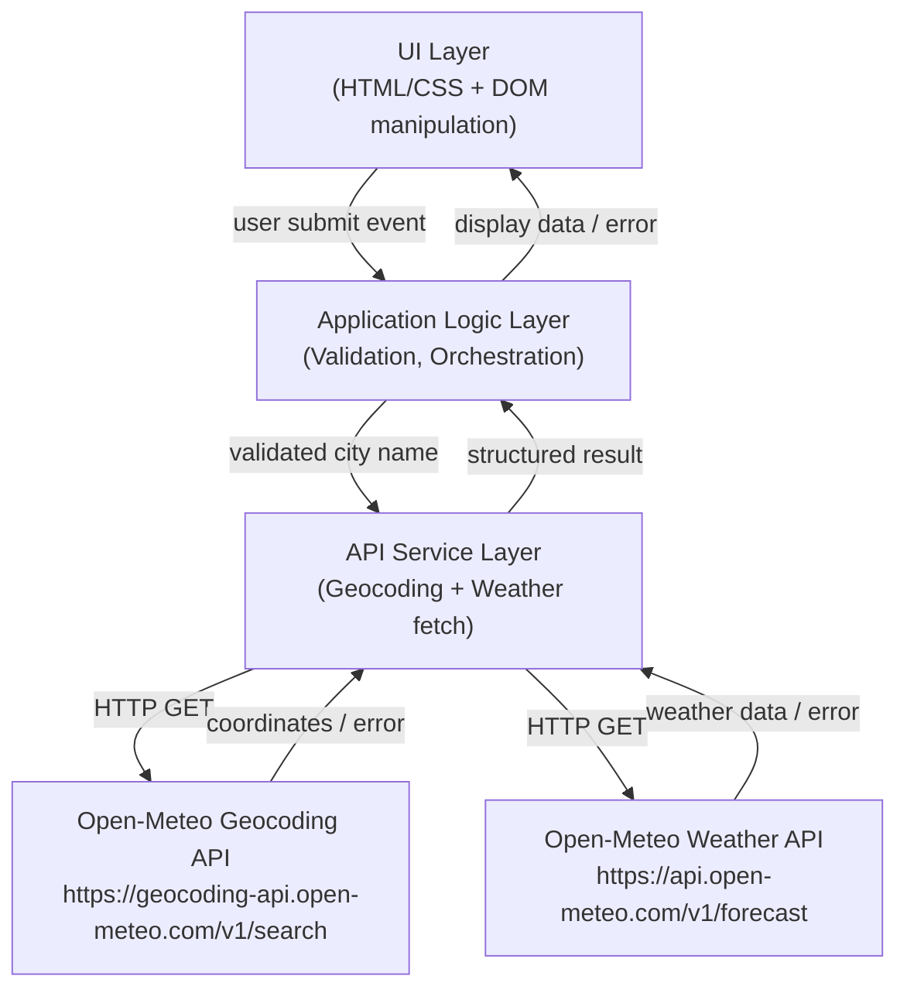
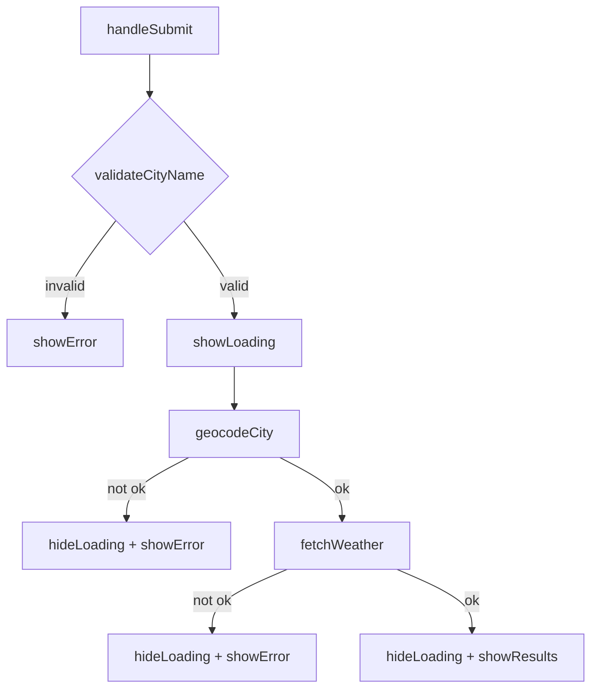

# Design Document

## Overview

La aplicación **Weather Forecast App** es una SPA (Single-Page Application) construida con HTML, CSS y JavaScript vanilla que permite a un usuario ingresar el nombre de una ciudad y obtener su pronóstico meteorológico actual (temperatura, humedad relativa y precipitaciones). La aplicación se comunica exclusivamente con dos endpoints públicos y gratuitos de [Open-Meteo](https://open-meteo.com): la Geocoding API y la Weather Forecast API. No requiere backend propio ni claves de API.

El flujo principal es:

1. El usuario escribe un nombre de ciudad y lo envía.
2. La app valida la entrada en el cliente.
3. La app llama a la Geocoding API para obtener las coordenadas de la ciudad.
4. Con las coordenadas, la app llama a la Weather API para obtener los datos actuales.
5. Los resultados se muestran en la interfaz.

---

## Architecture

La aplicación sigue una arquitectura de tres capas lógicas dentro de un único bundle cliente:



**Decisiones de diseño:**

- **Sin framework**: Se usa JavaScript vanilla para mantener cero dependencias externas de runtime y facilitar la ejecución en cualquier entorno académico sin pasos de build.
- **Separación de responsabilidades**: La validación, la orquestación y la comunicación con las APIs se encapsulan en módulos separados para facilitar las pruebas unitarias.
- **Timeout explícito**: Se utiliza `AbortController` + `setTimeout` para implementar el límite de 10 s en cada llamada HTTP, conforme a los Requisitos 2.4 y 3.3.
- **Sin caché**: Cada envío del formulario siempre genera nuevas peticiones de red, conforme al Requisito 5.3.

---

## Components and Interfaces

### 1. UI Component (`ui.js`)

Responsable de toda la manipulación del DOM: leer el input, mostrar/ocultar el spinner, mostrar resultados y mostrar errores.

```
interface UIComponent {
  getCityInput(): string
  showLoading(): void
  hideLoading(): void
  showResults(data: WeatherResult): void
  showError(message: string): void
  clearResults(): void
}
```

### 2. Validation Module (`validation.js`)

Valida el nombre de ciudad antes de cualquier llamada a la red.

```
interface ValidationResult {
  valid: boolean
  error?: string       // mensaje de error localizado (≤200 chars)
}

function validateCityName(raw: string): ValidationResult
```

Reglas implementadas (Requisito 1):
- Hace trim del input antes de validar.
- Rechaza vacío o solo espacios en blanco → código `EMPTY_CITY`.
- Rechaza longitud > 100 caracteres → código `CITY_TOO_LONG`.
- Rechaza caracteres que no sean letras Unicode, espacios, guiones (`-`) o apóstrofes (`'`) → código `INVALID_CHARS`.

### 3. Geocoding Service (`geocodingService.js`)

Encapsula la comunicación con la Geocoding API de Open-Meteo.

```
interface GeocodingResult {
  name: string         // nombre de la ciudad tal como lo devuelve la API
  latitude: number
  longitude: number
}

type GeocodingResponse =
  | { ok: true;  data: GeocodingResult }
  | { ok: false; error: 'not_found' | 'unavailable' | 'invalid_response' }

async function geocodeCity(cityName: string): Promise<GeocodingResponse>
```

Detalles de implementación:
- URL: `https://geocoding-api.open-meteo.com/v1/search?name={encoded}&count=1&language=es&format=json`
- Timeout: 10 s via `AbortController`.
- Toma el primer elemento de `results[]` (máxima relevancia, Requisito 2.2).
- Distingue tres casos de error: cero resultados (`not_found`), error de red/timeout/HTTP (`unavailable`), respuesta con estructura inesperada (`invalid_response`).

### 4. Weather Service (`weatherService.js`)

Encapsula la comunicación con la Weather Forecast API de Open-Meteo.

```
interface WeatherData {
  temperature: number       // °C  → current.temperature_2m
  relativeHumidity: number  // %   → current.relative_humidity_2m
  precipitation: number     // mm  → current.precipitation
}

type WeatherResponse =
  | { ok: true;  data: WeatherData }
  | { ok: false; error: 'unavailable' | 'invalid_data' }

async function fetchWeather(lat: number, lon: number): Promise<WeatherResponse>
```

Detalles de implementación:
- URL: `https://api.open-meteo.com/v1/forecast?latitude={lat}&longitude={lon}&current=temperature_2m,relative_humidity_2m,precipitation`
- Timeout: 10 s via `AbortController`.
- Extrae `current.temperature_2m`, `current.relative_humidity_2m`, `current.precipitation`.
- Si alguno de los tres valores está ausente o es no-numérico → `invalid_data` (Requisito 3.5).

### 5. App Controller (`app.js`)

Orquesta el flujo completo: suscribe el evento de envío, llama a validación → geocoding → weather → UI, y gestiona el spinner de carga.

```
async function handleSubmit(event: Event): void
```

Flujo interno:



---

## Data Models

### Entrada del usuario

```typescript
interface UserInput {
  raw: string       // texto tal cual del campo de texto
  trimmed: string   // raw.trim()
}
```

### Respuesta de Geocoding API (Open-Meteo)

```json
{
  "results": [
    {
      "id": 2950159,
      "name": "Berlin",
      "latitude": 52.52437,
      "longitude": 13.41053,
      "country": "Deutschland",
      "country_code": "DE"
    }
  ]
}
```

Si no hay resultados, el objeto contiene `results: []` o la clave `results` está ausente. Un error HTTP devuelve `{ "error": true, "reason": "..." }`.

### Respuesta de Weather API (Open-Meteo)

```json
{
  "latitude": 52.52,
  "longitude": 13.41,
  "current_units": {
    "temperature_2m": "°C",
    "relative_humidity_2m": "%",
    "precipitation": "mm"
  },
  "current": {
    "time": "2024-01-15T12:00",
    "temperature_2m": 5.2,
    "relative_humidity_2m": 78,
    "precipitation": 0.0
  }
}
```

### Modelo de resultado interno

```typescript
interface WeatherResult {
  cityName: string         // nombre exacto devuelto por Geocoding API
  temperature: number      // °C, máx. 2 decimales al mostrar
  relativeHumidity: number // %
  precipitation: number    // mm, máx. 2 decimales al mostrar
}
```

### Estados de la aplicación

```typescript
type AppState =
  | 'idle'       // estado inicial, sin resultados
  | 'loading'    // petición en curso
  | 'success'    // pronóstico mostrado
  | 'error'      // mensaje de error mostrado
```

---

## Correctness Properties

*A property is a characteristic or behavior that should hold true across all valid executions of a system — essentially, a formal statement about what the system should do. Properties serve as the bridge between human-readable specifications and machine-verifiable correctness guarantees.*

### Property 1: Nombres compuestos solo de espacios en blanco son rechazados

*Para cualquier* cadena compuesta únicamente por caracteres de espacio en blanco (espacio, tab, etc.) de longitud ≥ 1, `validateCityName` SHALL retornar `{ valid: false }` y la aplicación SHALL NOT realizar ninguna llamada de red.

**Validates: Requirements 1.2, 1.3**

### Property 2: El trim no cambia la validez de entradas válidas

*Para cualquier* nombre de ciudad válido `c`, añadir espacios en blanco arbitrarios al inicio y al final SHALL producir el mismo resultado de validación que `validateCityName(c)` — es decir, la validez no depende del padding de espacios.

**Validates: Requirements 1.4**

### Property 3: Caracteres inválidos en el nombre producen error de validación

*Para cualquier* cadena que contenga al menos un carácter distinto a letras Unicode, espacios, guiones (`-`) o apóstrofes (`'`), `validateCityName` SHALL retornar `{ valid: false }`.

**Validates: Requirements 1.6**

### Property 4: Nombres que superan los 100 caracteres son rechazados

*Para cualquier* cadena de longitud mayor a 100 caracteres, `validateCityName` SHALL retornar `{ valid: false }`, independientemente del contenido de los primeros 100 caracteres.

**Validates: Requirements 1.5**

### Property 5: La geocodificación siempre usa el primer resultado

*Para cualquier* respuesta de la Geocoding API que contenga uno o más resultados, `geocodeCity` SHALL extraer exclusivamente la latitud y la longitud del elemento en el índice 0 del array `results`.

**Validates: Requirements 2.2**

### Property 6: Respuestas malformadas de la Geocoding API producen error `invalid_response`

*Para cualquier* objeto de respuesta que no se ajuste a la estructura esperada de la Geocoding API (sin campo `results` de tipo array, o sin campos `name`/`latitude`/`longitude` en el primer elemento), `geocodeCity` SHALL retornar `{ ok: false, error: 'invalid_response' }`.

**Validates: Requirements 2.7**

### Property 7: El servicio de clima incluye las coordenadas y variables requeridas en la URL

*Para cualquier* par de coordenadas válidas `(lat, lon)`, `fetchWeather` SHALL construir una URL que incluya exactamente esos valores de latitud y longitud, y que solicite las variables `temperature_2m`, `relative_humidity_2m` y `precipitation` en el parámetro `current`.

**Validates: Requirements 3.1**

### Property 8: Los datos meteorológicos se extraen con fidelidad exacta

*Para cualquier* respuesta exitosa de la Weather API con valores numéricos `(t, h, p)` en `current.temperature_2m`, `current.relative_humidity_2m` y `current.precipitation`, `fetchWeather` SHALL retornar exactamente esos mismos valores numéricos sin transformación.

**Validates: Requirements 3.2**

### Property 9: Respuestas de la Weather API con campos faltantes o no-numéricos producen `invalid_data`

*Para cualquier* respuesta de la Weather API en la que al menos uno de los tres campos requeridos (`temperature_2m`, `relative_humidity_2m`, `precipitation`) esté ausente, sea `null` o tenga un valor no-numérico, `fetchWeather` SHALL retornar `{ ok: false, error: 'invalid_data' }`.

**Validates: Requirements 3.5**

### Property 10: Los resultados mostrados incluyen todos los campos con sus unidades

*Para cualquier* instancia de `WeatherResult`, `showResults` SHALL renderizar en el DOM el nombre de ciudad, el valor de temperatura seguido de `°C`, el valor de humedad seguido de `%`, y el valor de precipitaciones seguido de `mm`, todos como elementos visibles.

**Validates: Requirements 4.1, 4.3**

### Property 11: Nuevos resultados reemplazan completamente el estado anterior

*Para cualquier* estado previo de la UI (resultados anteriores, mensaje de error, o estado idle) y cualquier nuevo `WeatherResult`, invocar `showResults` SHALL eliminar el contenido previo y mostrar únicamente los nuevos datos.

**Validates: Requirements 4.2**

### Property 12: Los valores numéricos mostrados son fieles a los recibidos de la API

*Para cualquier* valor numérico de temperatura, humedad o precipitación recibido de la Weather API, el valor numérico mostrado en la UI SHALL diferir del valor original en menos de `0.005` (tolerancia máxima de redondeo a 2 decimales).

**Validates: Requirements 5.1**

### Property 13: El nombre de ciudad se muestra exactamente como lo devuelve la API

*Para cualquier* cadena `n` (incluyendo caracteres Unicode, diacríticos y mayúsculas) devuelta como `name` por la Geocoding API, la UI SHALL mostrar exactamente `n` sin ninguna transformación de caracteres.

**Validates: Requirements 5.2**

### Property 14: Envíos repetidos siempre generan nuevas peticiones de red

*Para cualquier* nombre de ciudad válido, enviar el mismo nombre dos veces consecutivas SHALL producir exactamente dos llamadas independientes a la Weather API (sin reutilizar respuestas previas en caché).

**Validates: Requirements 5.3**

### Property 15: Todos los mensajes de error tienen como máximo 200 caracteres

*Para cualquier* código de error definido en la aplicación, el mensaje de error asociado SHALL tener una longitud de cadena menor o igual a 200 caracteres.

**Validates: Requirements 4.4**

---

## Error Handling

| Escenario | Código de error | Mensaje mostrado al usuario |
|---|---|---|
| Ciudad vacía o solo espacios | `EMPTY_CITY` | "El nombre de ciudad es requerido." |
| Ciudad supera 100 caracteres | `CITY_TOO_LONG` | "El nombre de ciudad no debe superar los 100 caracteres." |
| Caracteres inválidos | `INVALID_CHARS` | "El nombre de ciudad contiene caracteres inválidos. Use solo letras, espacios, guiones o apóstrofes." |
| Ciudad no encontrada (0 resultados) | `CITY_NOT_FOUND` | "No se encontró la ciudad. Verifica el nombre e intenta de nuevo." |
| Geocoding API timeout o error de red | `GEO_UNAVAILABLE` | "El servicio de geocodificación no está disponible. Intenta más tarde." |
| Geocoding API respuesta malformada | `GEO_INVALID_RESPONSE` | "El servicio de geocodificación devolvió una respuesta inesperada." |
| Weather API timeout o error de red | `WEATHER_UNAVAILABLE` | "El servicio meteorológico no está disponible. Intenta más tarde." |
| Weather API datos faltantes o no-numéricos | `WEATHER_INVALID_DATA` | "Los datos meteorológicos no pudieron ser procesados." |

**Principios generales:**
- Todos los errores ocultan el panel de resultados y muestran únicamente el mensaje de error en la UI.
- Los errores de validación se muestran sin realizar ninguna llamada de red.
- El spinner de carga se oculta siempre en el bloque `finally` del flujo async, incluso si ocurre un error.
- Todos los mensajes de error tienen ≤ 200 caracteres (verificable con Property 15).

---

## Testing Strategy

### Enfoque dual: pruebas unitarias + pruebas basadas en propiedades

La aplicación implementa dos niveles de prueba complementarios:

#### 1. Pruebas unitarias (ejemplo-basadas)

Se usa [Vitest](https://vitest.dev/) como test runner. Las pruebas unitarias cubren:

- Casos concretos de `validateCityName` (nombre válido, vacío, solo espacios, caracteres especiales conocidos, longitud exactamente 100 vs 101).
- Comportamiento de `geocodingService` ante respuestas mock exitosas, cero resultados, timeout y error HTTP.
- Comportamiento de `weatherService` ante respuestas mock exitosas, timeout, error HTTP y campos faltantes.
- Lógica del `app.js` controller: que el spinner aparece/desaparece correctamente y que el flujo llama a cada servicio en orden.
- Casos borde: campos `null`, `undefined`, `NaN` en respuestas de la API.

#### 2. Pruebas basadas en propiedades (PBT)

Se usa [fast-check](https://github.com/dubzzz/fast-check) para las propiedades universales. Cada test ejecuta un mínimo de **100 iteraciones**.

Cada prueba de propiedad está etiquetada con el comentario:
```
// Feature: weather-forecast-app, Property N: <texto de la propiedad>
```

| Propiedad | Módulo | Generador fast-check |
|---|---|---|
| Property 1: Whitespace rechazado | `validateCityName` | `fc.stringOf(fc.char().filter(c => /\s/.test(c)), {minLength: 1})` |
| Property 2: Trim invariante | `validateCityName` | Nombres válidos + padding con `fc.string()` de espacios |
| Property 3: Chars inválidos rechazados | `validateCityName` | `fc.string()` con al menos 1 char prohibido inyectado |
| Property 4: Longitud > 100 rechazada | `validateCityName` | `fc.string({ minLength: 101 })` |
| Property 5: Primer resultado usado | `geocodingService` | `fc.array(fc.record({name: fc.string(), latitude: fc.float(), longitude: fc.float()}), {minLength: 1})` |
| Property 6: Respuesta malformada → error | `geocodingService` | `fc.object()` sin conformidad con esquema esperado |
| Property 7: URL con coordenadas y params correctos | `weatherService` | `fc.tuple(fc.float({min:-90,max:90}), fc.float({min:-180,max:180}))` |
| Property 8: Extracción fiel de datos | `weatherService` | `fc.record({temperature_2m: fc.float(), relative_humidity_2m: fc.float(), precipitation: fc.float()})` |
| Property 9: Campos faltantes → invalid_data | `weatherService` | Objetos con ≥1 campo requerido ausente o no-numérico |
| Property 10: Todos los campos con unidades | `UI showResults` | `fc.record({cityName: fc.string(), temperature: fc.float(), relativeHumidity: fc.float(), precipitation: fc.float()})` |
| Property 11: Nuevos datos reemplazan estado anterior | `UI showResults` | Cualquier `WeatherResult` generado aleatoriamente |
| Property 12: Fidelidad numérica en display | `UI display logic` | `fc.float({ noNaN: true })` para cada valor meteorológico |
| Property 13: Nombre preservado exactamente | `UI showResults` | `fc.string()` (Unicode-aware) como nombre de ciudad |
| Property 14: Sin caché, siempre nueva petición | `app.js` + mock fetch | Cualquier nombre de ciudad válido, submiteado dos veces |
| Property 15: Mensajes ≤ 200 chars | Constantes de mensajes | Iteración sobre todos los códigos de error definidos |

**Configuración de fast-check:**
```javascript
fc.assert(fc.property(/* ... */), { numRuns: 100 })
```

#### 3. Pruebas de integración (manuales / e2e básico)

Estas pruebas se ejecutan manualmente y cubren escenarios que involucran servicios externos reales:

- Verificación con la Geocoding API real para ciudades conocidas (Lima, Berlin, Tokyo).
- Verificación manual del timeout simulando red lenta con Chrome DevTools → Network → Slow 3G.
- Verificación del spinner de carga con respuestas lentas artificiales.

Estas pruebas no se automatizan como PBT porque involucran llamadas a servicios externos de alto costo y comportamiento que no varía significativamente con la variación del input en ese contexto.
